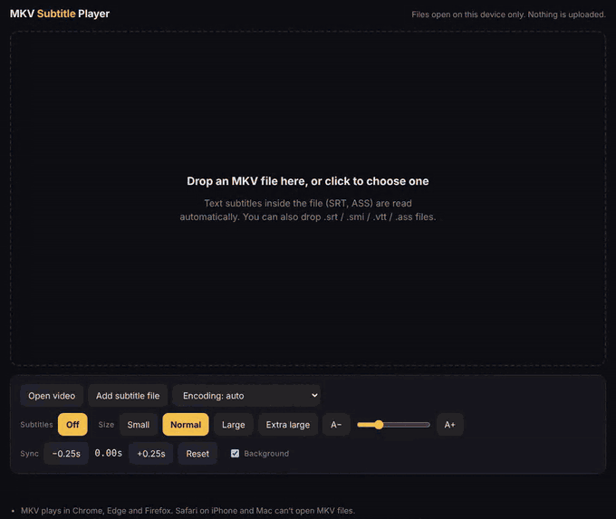

# MKV 자막 플레이어

MKV 영상을 자막과 함께 보는 플레이어. 맥 앱(Electron)과 브라우저에서 여는 웹 버전, MKV → MP4 변환 스크립트가 있어요.

**바로 써 보기: https://jinex001.github.io/mkv-subtitle-player/** · [맥 앱 받기](https://github.com/jinex001/mkv-subtitle-player/releases/latest) · [English](README.md)



## 할 수 있는 것

- MKV 안에 든 글자 자막(SRT·ASS·SSA·WebVTT, zlib 압축 포함)을 직접 읽어서 표시
- 따로 있는 자막 파일: `.srt` `.smi`/`.sami` `.vtt` `.ass`/`.ssa`
  - SMI는 언어(Class)마다 따로 나눠서 고를 수 있음 (한국어·영어 등)
  - 인코딩 자동 판별: UTF-8·UTF-16, EUC-KR, Shift_JIS, GBK, Big5, Windows-1250~1258, KOI8-R. 시스템 언어로 애매한 경우를 가르고, 직접 고를 수도 있음
- 화면 언어는 OS·브라우저 언어를 따라감(한국어·영어·일본어·중국어 간체/번체·스페인어·포르투갈어·독일어·프랑스어), 자막도 그 언어 것을 먼저 켬
- 자막 크기(영상 높이 기준이라 전체 화면에서도 같은 비율), 싱크 ±0.25초, 자막 배경 켜고 끄기
- 단축키: `Space` 재생/멈춤 · `←` `→` 5초 · `Z` `X` 싱크 · `−` `+` 자막 크기 · `F` 전체 화면

못 하는 것: 그림 자막(PGS, VobSub), ASS 꾸밈(색·위치), AC-3·DTS 음성(브라우저 엔진이 못 풂).

## 폴더

| 폴더 | 내용 |
| --- | --- |
| `mac/` | 맥 앱. Finder "다음으로 열기"·Dock에 끌어다 놓기, 영화 옆 같은 이름 자막(`영화.srt`, `영화.ko.smi`) 자동으로 붙이기, ⌘O / ⇧⌘O |
| `web/` | 웹 플레이어: `index.html`, `player.js`, `i18n.js`(화면 문구), `encoding.js`(인코딩 판별). Chrome·Edge·Firefox에서 열기. Safari는 MKV 재생 안 됨 |
| `tests/` | `node tests/encoding.test.cjs`: 22가지 언어·인코딩 시험 파일로 인코딩 판별 확인 |
| `tools/mkv2mp4.sh` | MKV → MP4 변환(ffmpeg). 영상은 가능하면 그대로 복사, 음성은 AAC, 글자 자막은 MP4 자막으로. `--burn`이면 자막을 영상에 새김. AirPlay·Apple 기기용 |

## 맥 앱 만들기

```bash
cd mac
npm install
npm start            # 개발용으로 바로 실행
npm run pack:arm64   # Apple Silicon 앱 → mac/dist/
npm run pack:x64     # 인텔 맥 앱
```

Apple 공증을 받지 않은 앱이라, 받은 앱을 처음 열 땐 한 번 이렇게 해 줘야 해요.

```bash
xattr -cr "/Applications/MKV Subtitle Player.app"
```

리눅스에서 직접 묶은 앱은 `codesign --force --deep --sign - "/Applications/MKV Subtitle Player.app"`도 필요해요. 릴리스는 `v*` 태그를 올리면 `.github/workflows/release.yml`이 맥에서 빌드·서명해서 올려요.

## MP4로 바꾸기

```bash
brew install ffmpeg
tools/mkv2mp4.sh 영화.mkv            # 자막을 켜고 끌 수 있는 MP4
tools/mkv2mp4.sh --burn 영화.mkv     # 자막을 영상에 새김 (어디서나 보임, 느림)
```

맥 앱은 `web/`을 그대로 가져다 써요(`npm start`·`pack`이 복사함). 플레이어는 `web/`에서만 고치면 돼요.

## 라이선스

MIT
