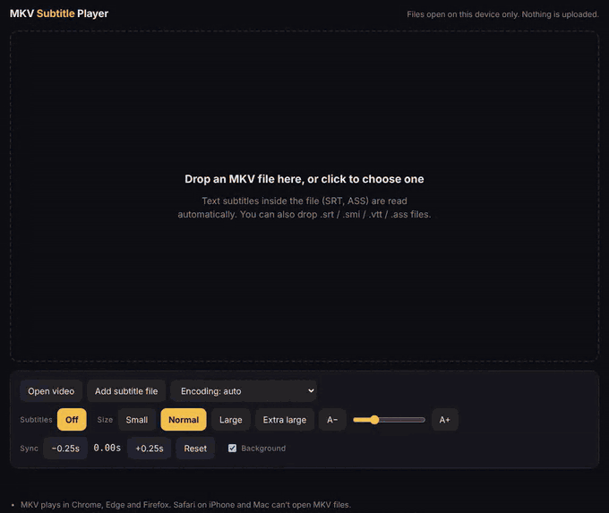

# MKV Subtitle Player

Play MKV and MP4 videos with subtitles — in your browser or as a Mac app. Subtitles inside the video are read directly, and outside subtitle files in **any old encoding** (Windows-1251, Shift_JIS, EUC-KR, Big5, …) are detected automatically, so letters don't come out garbled.

Files open on your device only. Nothing is uploaded, and the page makes no network requests.

**Try it: https://jinex001.github.io/mkv-subtitle-player/** · [Mac app](https://github.com/jinex001/mkv-subtitle-player/releases/latest) · [한국어](README.ko.md)



## Features

- **Subtitles inside the video**: MKV text tracks (SRT, ASS/SSA, WebVTT, including zlib-compressed ones) and MP4/MOV subtitles (mov_text/tx3g, WebVTT) are read straight from the file while it plays
- **Subtitle files**: `.srt`, `.smi` / `.sami`, `.vtt`, `.ass` / `.ssa`
  - SMI files with several languages are split into one track per language
- **Automatic encoding detection** for old subtitle files:

  | Languages | Encodings |
  | --- | --- |
  | Unicode | UTF-8, UTF-16 (with or without BOM) |
  | Korean · Japanese · Chinese | EUC-KR/CP949 · Shift_JIS · GBK/GB18030 · Big5 |
  | Western Europe | Windows-1252 |
  | Central Europe (pl, cs, hu, ro, hr…) | Windows-1250 |
  | Cyrillic (ru, uk, bg, sr) | Windows-1251, KOI8-R |
  | Greek · Turkish · Hebrew · Arabic | Windows-1253 · 1254 · 1255 · 1256 |
  | Baltic · Vietnamese | Windows-1257 · 1258 |

  Your system languages break near-ties. You can always pick the encoding by hand.
- **Picks your language**: the interface follows your OS / browser language, and the subtitle track in your language is turned on first
- **Fix sound** (Mac app): AC-3, E-AC-3, DTS and TrueHD audio can't be played by the browser engine. The app notices, and one click re-encodes just the audio to AAC with your ffmpeg (`brew install ffmpeg`) and continues where you were
- Subtitle size (scales with the video, also in full screen), timing ±0.25 s, background on/off
- Shortcuts: `Space` play/pause · `←` `→` 5 s · `Z` `X` timing · `−` `+` size · `F` full screen

Interface languages: English, 한국어, 日本語, 简体中文, 繁體中文, Español, Português, Deutsch, Français.

Not supported: image-based subtitles (PGS, VobSub) and ASS styling (colors, positions). In the browser, AC-3/DTS audio stays silent (the Mac app can fix it).

## Use it

- **Browser**: open https://jinex001.github.io/mkv-subtitle-player/ in Chrome, Edge or Firefox and drop an MKV on it (or open `web/index.html` locally). Safari can't play MKV.
- **Mac app**: download from [Releases](https://github.com/jinex001/mkv-subtitle-player/releases/latest). It also opens files from Finder ("Open With", or drop on the Dock icon) and picks up subtitle files next to the movie with the same name (`Movie.srt`, `Movie.ko.smi`).

## Build the Mac app

```bash
cd mac
npm install
npm start            # run it
npm run pack:arm64   # Apple Silicon app in mac/dist/
npm run pack:x64     # Intel app
```

The app is not notarized by Apple, so macOS blocks a downloaded copy on first launch. Run once:

```bash
xattr -cr "/Applications/MKV Subtitle Player.app"
```

A copy you packed yourself on Linux also needs `codesign --force --deep --sign - "/Applications/MKV Subtitle Player.app"`. Releases are built and signed ad hoc by `.github/workflows/release.yml` on every `v*` tag.

## Convert MKV to MP4 (for AirPlay and Apple devices)

```bash
brew install ffmpeg
tools/mkv2mp4.sh Movie.mkv          # MP4 with switchable subtitles (old encodings and SMI handled, needs node)
tools/mkv2mp4.sh --burn Movie.mkv   # subtitles burned into the picture
```

## Project layout

| Path | What |
| --- | --- |
| `web/` | The player: `index.html`, `player.js`, `i18n.js` (interface text), `encoding.js` (encoding detection) |
| `mac/` | Electron wrapper. `npm start` / `pack` copy `web/` into the app |
| `tools/mkv2mp4.sh` | ffmpeg-based MKV → MP4 converter; `tools/prepare-sub.cjs` converts old encodings and splits SMI by language |
| `tests/` | `node tests/encoding.test.cjs` checks encoding detection against sample files in 22 encodings/languages |

## Add a language

Copy the `en` block in `web/i18n.js`, translate it, and add the menu words in `mac/main.js`.

## License

MIT
